<div align="center">



# 🚀 Awesome Freemium Business Suite

### *The Definitive Curated Directory of Free-Tier SaaS & Self-Hosted Open-Source Business Platforms*

<p align="center">
  <a href="https://github.com/ishandutta2007/Awesome-Awesome-Awesome"></a><a href="https://discord.gg/jc4xtF58Ve"></a>
  <a href="https://github.com/ishandutta2007/Awesome-Freemium-Business-Suite/stargazers"></a>
  <a href="https://github.com/ishandutta2007/Awesome-Freemium-Business-Suite/network/members"></a>
  <a href="https://github.com/ishandutta2007/Awesome-Freemium-Business-Suite/blob/main/LICENSE"></a>
  <a href="https://github.com/ishandutta2007/Awesome-Freemium-Business-Suite/pulls"></a>
  <a href="https://github.com/ishandutta2007"></a>
</p>

**Discover production-ready CRM, project management, team collaboration, ERP, and no-code database platforms with zero-dollar starting tiers.**

</div>

---

## 📑 Table of Contents

- [🌐 Sector Overview & Market Dynamics](#-sector-overview--market-dynamics)
- [🏢 SaaS & Hosted Platforms](#-saas--hosted-platforms)
- [🔓 Open-Source GitHub Projects](#-open-source-github-projects)
- [🏗️ Self-Hosted Architecture Blueprint](#️-self-hosted-architecture-blueprint)
- [🤝 How to Contribute](#-how-to-contribute)
- [📈 Star History](#-star-history)
- [💖 Support & Sponsoring](#-support--sponsoring)
- [⚖️ Disclaimer](#️-disclaimer)

---

## 🌐 Sector Overview & Market Dynamics

The global business software ecosystem—spanning customer relationship management (CRM), project coordination, enterprise resource planning (ERP), and team collaboration—is valued at approximately **$320 billion** and projected to surge past **$650 billion by 2030** (CAGR ~13.5%).

The sector exhibits **moderate fragmentation with a bifurcated barbell distribution**: legacy hyperscalers (Salesforce, Microsoft, Alphabet) maintain concentrated control over global enterprise procurement, while an aggressive, highly competitive long tail of product-led freemium SaaS disruptors (Notion, Airtable, ClickUp, HubSpot) and self-hosted open-source stacks (Odoo, Twenty, Plane, AppFlowy) dominate startups, developers, and SMEs—preventing any single winner-take-all monopoly and driving perpetual innovation across free tiers.

---

## 🏢 SaaS & Hosted Platforms

> [!NOTE]  
> All platforms below offer either a permanent **free-forever tier** or a dedicated trial, allowing startups and small teams to operate at zero initial software cost. Entries are sorted descending by company scale (Valuation / Market Capitalization / Annual Revenue).

| 🏢 Platform | 💰 Starting Paid Price | 🎁 Free Tier Limits | 📊 Company Scale (Valuation / Revenue) | 🎯 Primary Category |
| :--- | :--- | :--- | :--- | :--- |
| **[Google Workspace](https://workspace.google.com/)** | **$6.00** / user / mo *(Business Starter, annual billing)* | **Free personal tier**: 15 GB cloud storage across Drive/Gmail/Photos, Docs, Sheets, Slides, and Google Meet (100 participants, 60-min limit). Business edition offers 14-day full free trial (up to 10 users). | **~$2.10 Trillion** Market Cap *(Alphabet)* • **~$350B** Annual Revenue | 📄 Office Suite & Cloud Collaboration |
| **[Salesforce](https://www.salesforce.com/)** | **$25.00** / user / mo *(Starter Suite, annual billing)* | **30-Day Free Trial** of Starter Suite with full CRM pipeline, lead capture, email integration, and reports. **Developer Edition is free forever** with 2 Salesforce licenses, 5 MB data storage, and 20 MB file storage. | **~$290 Billion** Market Cap • **~$38B** Annual Revenue | 💼 Enterprise CRM & Sales Pipeline |
| **[Trello](https://trello.com/)** | **$5.00** / user / mo *(Standard, annual billing)* | **Free forever plan**: Unlimited cards, up to 10 workspace boards, unlimited Power-Ups per board, 10 MB per file attachment limit, 250 Workspace automation command runs/month. | **~$40 Billion** Market Cap *(Atlassian)* • **~$4.4B** Annual Revenue | 📋 Visual Kanban & Task Management |
| **[HubSpot](https://www.hubspot.com/)** | **$15.00** / seat / mo *(Starter Customer Platform, annual billing)* | **Free forever plan**: Up to 5 users, up to 1,000,000 contacts, 1 deal pipeline, 5 email templates, 1 shared inbox, 1 meeting scheduling page, 2,000 marketing email sends/month. | **~$32 Billion** Market Cap • **~$2.6B** Annual Revenue | 🧲 Inbound Marketing & Growth CRM |
| **[Slack](https://slack.com/)** | **$7.25** / user / mo *(Pro, annual billing)* | **Free forever plan**: 90 days of searchable message & file history, 10 third-party app integrations, 1:1 audio & video huddles, 5 GB storage per workspace, canvas collaborative docs. | **~$27.7 Billion** Acquisition Valuation *(Salesforce)* • **~$1.5B** Annual Revenue | 💬 Team Chat & Workspace Hub |
| **[Monday.com](https://monday.com/)** | **$9.00** / seat / mo *(Basic, annual billing; min 3 seats = $27/mo)* | **Free forever plan**: Up to 2 seats, up to 3 boards, 200 items/rows maximum, 500 MB cloud file storage, 200+ pre-built workflow templates, iOS and Android mobile apps. | **~$14.0 Billion** Market Cap • **~$850M** Annual Revenue | 📊 Work OS & Workflow Management |
| **[Airtable](https://www.airtable.com/)** | **$20.00** / seat / mo *(Team, annual billing)* | **Free forever plan**: Up to 5 editors/collaborators, 1,000 records per base, 1 GB file attachments per base, unlimited bases, standard grid, calendar, form, and kanban views. | **~$11.7 Billion** Private Valuation • **~$250M** Annual Revenue | 🗄️ Relational No-Code Database |
| **[Notion](https://www.notion.so/)** | **$10.00** / user / mo *(Plus, annual billing)* | **Free forever plan**: Unlimited blocks for individuals, up to 10 guest collaborators, 5 MB file upload limit per file, 7-day page version history, basic page analytics, collaborative docs. | **~$10.0 Billion** Private Valuation • **~$350M** Annual Revenue | 📝 Connected Workspace, Wikis & Docs |
| **[Zoho One / CRM](https://www.zoho.com/)** | **$14.00** / user / mo *(Zoho CRM Standard, annual billing)* | **Free forever plan**: Up to 3 users, 5,000 records, standard contact/lead management, mobile CRM app, workflow email notifications, 1 GB storage. Zoho One offers 30-day all-inclusive free trial. | **~$10.0 Billion** Valuation *(Bootstrapped)* • **~$1.5B** Annual Revenue | 🏢 Unified Business Suite & CRM |
| **[ClickUp](https://clickup.com/)** | **$7.00** / user / mo *(Unlimited, annual billing)* | **Free forever plan**: Unlimited team members/guests, 100 MB cloud storage, unlimited tasks, collaborative docs, real-time chat, Kanban boards, sprint management, 2FA. | **~$4.0 Billion** Private Valuation • **~$200M** Annual Revenue | ⚡ All-in-One Agile Project Suite |
| **[Asana](https://asana.com/)** | **$10.99** / user / mo *(Starter, annual billing)* | **Free forever plan**: Up to 10 teammates, unlimited tasks, unlimited projects, unlimited messages, activity log, list and board views, calendar view, 100+ free integrations. | **~$3.2 Billion** Market Cap • **~$720M** Annual Revenue | 🎯 Enterprise Work & Task Tracker |
| **[Bitrix24](https://www.bitrix24.com/)** | **$49.00** / org / mo *(Basic total for 5 users, annual billing)* | **Free forever plan**: Unlimited users, 5 GB cloud storage, CRM (contacts/deals/leads/invoices), tasks & projects, company chat, HD video calls (up to 48 participants). | **~$600 Million** Estimated Valuation • **~$120M** Annual Revenue | 🌐 Unified Collaboration & Social Intranet |

---

## 🔓 Open-Source GitHub Projects

> [!TIP]  
> Self-hosted solutions provide complete data sovereignty, zero per-seat licensing fees, and freedom from vendor lock-in.  
> **Sorted descending by real-time GitHub Star count.** Click any star badge to inspect the repository stargazers.

- **[AppFlowy](https://github.com/AppFlowy-IO/AppFlowy)** [](https://github.com/AppFlowy-IO/AppFlowy/stargazers) `AGPL-3.0`  
  Privacy-first open-source Notion alternative built with Flutter and Rust. Provides modular documents, multi-view databases (Kanban, Grid, Calendar), offline-first architecture, end-to-end encryption, and full self-hosting.

- **[AFFiNE](https://github.com/toeverything/AFFiNE)** [](https://github.com/toeverything/AFFiNE/stargazers) `MIT`  
  Next-generation all-in-one collaborative workspace that merges documents, whiteboards, and multimodal databases. Built as a local-first alternative to Notion and Miro with real-time peer sync and vector canvas.

- **[NocoDB](https://github.com/nocodb/nocodb)** [](https://github.com/nocodb/nocodb/stargazers) `AGPL-3.0`  
  Open-source Airtable alternative that connects to MySQL, PostgreSQL, SQL Server, and SQLite, transforming existing relational databases into smart collaborative spreadsheets with auto-generated REST/GraphQL APIs.

- **[Plane](https://github.com/makeplane/plane)** [](https://github.com/makeplane/plane/stargazers) `Apache-2.0`  
  Modern open-source project and issue tracking system designed as an extensible Jira and Linear alternative. Features issues, cycles, modules, roadmaps, analytics, page documents, and native GitHub synchronization.

- **[Twenty](https://github.com/twentyhq/twenty)** [](https://github.com/twentyhq/twenty/stargazers) `AGPL-3.0`  
  Modern, scalable open-source CRM engineered as a direct Salesforce alternative. Features customizable data models, visual Kanban deal pipelines, GraphQL/REST APIs, email and calendar synchronization, and role-based permissions.

- **[Odoo](https://github.com/odoo/odoo)** [](https://github.com/odoo/odoo/stargazers) `LGPL-3.0`  
  Comprehensive open-source enterprise suite covering CRM, sales pipelines, inventory, point of sale, e-commerce, and accounting. Extremely mature ecosystem with thousands of community modules.

- **[Cal.com](https://github.com/calcom/cal.com)** [](https://github.com/calcom/cal.com/stargazers) `AGPL-3.0`  
  Open-source scheduling infrastructure and Calendly alternative. Features multi-calendar synchronization, customizable booking workflows, round-robin assignments, payment gateways, and self-hosted privacy.

- **[ERPNext](https://github.com/frappe/erpnext)** [](https://github.com/frappe/erpnext/stargazers) `GPL-3.0`  
  Full-featured open-source ERP system built on the Frappe framework. Encompasses accounting, HR, payroll, CRM, manufacturing, purchasing, and project tracking with zero per-user licensing fees.

- **[Mattermost](https://github.com/mattermost/mattermost)** [](https://github.com/mattermost/mattermost/stargazers) `Apache-2.0`  
  Secure open-source collaboration platform and Slack alternative designed for technical teams. Supports persistent channel messaging, audio huddles, workflow playbooks, and self-hosted compliance.

- **[Chatwoot](https://github.com/chatwoot/chatwoot)** [](https://github.com/chatwoot/chatwoot/stargazers) `MIT`  
  Open-source customer engagement suite and Intercom / Zendesk alternative. Features omnichannel shared inboxes (email, website chat, WhatsApp, Facebook, SMS), CRM contact tracking, and bot integrations.

- **[Nextcloud](https://github.com/nextcloud/server)** [](https://github.com/nextcloud/server/stargazers) `AGPL-3.0`  
  Self-hosted productivity suite and private cloud replacing Google Workspace and Microsoft 365. Includes Nextcloud Files, Talk (video meetings/chat), Groupware (Mail/Calendar/Contacts), and Nextcloud Office.

- **[Huly](https://github.com/hcengineering/platform)** [](https://github.com/hcengineering/platform/stargazers) `Elastic-2.0`  
  All-in-one open-source digital workspace integrating issue tracking, CRM, team chat, HR operations, and collaborative documents. Engineered to replace Jira, Linear, Slack, and Notion in a unified interface.

- **[Focalboard](https://github.com/mattermost/focalboard)** [](https://github.com/mattermost/focalboard/stargazers) `MIT`  
  Open-source multilingual project management platform from Mattermost. Offers Kanban boards, table views, and card tracking as a self-hosted alternative to Trello, Notion, and Asana.

- **[Krayin CRM](https://github.com/krayin/laravel-crm)** [](https://github.com/krayin/laravel-crm/stargazers) `MIT`  
  Lightweight open-source CRM framework built on Laravel. Features lead pipeline visualization, contact management, sales quotations, automated workflows, and a modular architecture tailored for SMEs.

- **[Wekan](https://github.com/wekan/wekan)** [](https://github.com/wekan/wekan/stargazers) `MIT`  
  Open-source collaborative Kanban board platform built with Meteor and Node.js. Allows teams to maintain absolute data control with card swimlanes, custom fields, and LDAP/OAuth authentication.

- **[OpenProject](https://github.com/opf/openproject)** [](https://github.com/opf/openproject/stargazers) `GPL-3.0`  
  Enterprise-grade open-source project management software supporting classic, agile, and hybrid workflows. Includes interactive Gantt charts, Agile boards, work package hierarchies, and cost budgets.

- **[Planka](https://github.com/plankanban/planka)** [](https://github.com/plankanban/planka/stargazers) `AGPL-3.0`  
  Real-time Kanban board for small teams built with React and Redux. Offers card timers, markdown card descriptions, attachments, member assignments, and self-hosted Docker deployment.

- **[Leantime](https://github.com/Leantime/leantime)** [](https://github.com/Leantime/leantime/stargazers) `AGPL-3.0`  
  Strategic open-source project management system combining lean methodologies, design thinking, and Agile delivery. Features goal tracking, strategy canvases, milestone roadmaps, and AI assistance.

- **[Kanboard](https://github.com/kanboard/kanboard)** [](https://github.com/kanboard/kanboard/stargazers) `MIT`  
  Minimalist, ultra-fast open-source Kanban task manager built in PHP. Focuses on simplicity, automated subtask workflows, visual limits (WIP), and low resource footprint.

- **[Dolibarr](https://github.com/Dolibarr/dolibarr)** [](https://github.com/Dolibarr/dolibarr/stargazers) `GPL-3.0`  
  Modular open-source ERP & CRM suite designed for small to mid-sized businesses, foundations, and freelancers. Features invoices, commercial proposals, orders, stock, and project coordination.

- **[Baserow](https://github.com/baserow/baserow)** [](https://github.com/baserow/baserow/stargazers) `MIT`  
  Modern open-source no-code database built with Django and Nuxt.js. Serves as a modular Airtable alternative supporting unlimited rows, real-time collaboration, form builders, and custom plugins.

- **[Redmine](https://github.com/redmine/redmine)** [](https://github.com/redmine/redmine/stargazers) `GPL-2.0`  
  Battle-tested Ruby on Rails open-source issue tracker and project management platform. Features flexible role-based access control, Gantt charts, calendar views, wikis, and an expansive plugin catalog.

- **[SuiteCRM](https://github.com/SuiteCRM/SuiteCRM)** [](https://github.com/SuiteCRM/SuiteCRM/stargazers) `AGPL-3.0`  
  Enterprise-grade open-source CRM system originally forked from SugarCRM. Features customer journey workflows, quote generation, contract management, case ticketing, and multi-currency billing.

- **[Vikunja](https://github.com/go-vikunja/vikunja)** [](https://github.com/go-vikunja/vikunja/stargazers) `AGPL-3.0`  
  Modern self-hosted to-do list and task coordination platform built with Go and Vue. Features multiple task views (list, table, Kanban, Gantt), reminders, recurring tasks, and CalDAV synchronization.

- **[Frappe CRM](https://github.com/frappe/crm)** [](https://github.com/frappe/crm/stargazers) `AGPL-3.0`  
  Modern, lightning-fast CRM built on the Frappe framework and Vue.js. Provides lead and deal pipelines, contact activity logs, integrated email messaging, call logging, and seamless ERPNext connectivity.

- **[EspoCRM](https://github.com/espocrm/espocrm)** [](https://github.com/espocrm/espocrm/stargazers) `AGPL-3.0`  
  High-performance open-source CRM with an intuitive responsive UI. Delivers lead capture, sales opportunities, email integration, calendar coordination, role permissions, and custom entity builders.

---

## 🏗️ Self-Hosted Architecture Blueprint

You can assemble a world-class, **$0/month enterprise-grade suite** by orchestrating modern open-source microservices:

```
┌────────────────────────────────────────────────────────┐
│                   Reverse Proxy / SSL                  │
│               (Traefik / Nginx / Caddy)                │
└───────────────────────────┬────────────────────────────┘
                            │
       ┌────────────────────┼────────────────────┐
       ▼                    ▼                    ▼
┌──────────────┐     ┌──────────────┐     ┌──────────────┐
│  Twenty CRM  │     │  Plane / PM  │     │ NocoDB Base  │
│  (Customers) │     │ (Tasks/Sprints)    │  (Databases) │
└──────┬───────┘     └──────┬───────┘     └──────┬───────┘
       │                    │                    │
       └────────────────────┼────────────────────┘
                            ▼
              ┌───────────────────────────┐
              │   Shared PostgreSQL DB    │
              │  Docker Compose / Storage │
              └───────────────────────────┘
```

1. **CRM & Customer Pipeline**: Deploy **[Twenty](https://github.com/twentyhq/twenty)** or **[EspoCRM](https://github.com/espocrm/espocrm)**.
2. **Project & Sprint Tracking**: Deploy **[Plane](https://github.com/makeplane/plane)** or **[OpenProject](https://github.com/opf/openproject)**.
3. **No-Code Data & Spreadsheets**: Deploy **[NocoDB](https://github.com/nocodb/nocodb)** or **[Baserow](https://github.com/baserow/baserow)**.
4. **Knowledge Base & Wiki**: Deploy **[AppFlowy](https://github.com/AppFlowy-IO/AppFlowy)** or **[AFFiNE](https://github.com/toeverything/AFFiNE)**.
5. **Team Communication**: Deploy **[Mattermost](https://github.com/mattermost/mattermost)** or **[Chatwoot](https://github.com/chatwoot/chatwoot)**.

---

## 🤝 How to Contribute

Contributions are warmly welcomed! To suggest a new tool or update existing entries:

1. 🍴 **Fork the repository** on GitHub.
2. 🌿 **Create a descriptive branch**: `git checkout -b feature/add-tool-name`.
3. 📝 **Edit `README.md`**: Follow the established table/list formatting. Provide accurate pricing, free tier limits, company scale, and official repository links.
4. 🚀 **Commit your changes**: `git commit -m "Add ToolName to Freemium Business Suite"`.
5. 📬 **Open a Pull Request**: Provide a brief summary of why the tool is suitable for growing teams.

---

## 📈 Star History

[](https://star-history.dera.page/#ishandutta2007/Awesome-Freemium-Business-Suite&type=date&legend=top-left)

---

## 💖 Support & Sponsoring

If you found this curated directory helpful for your startup, business, or development workflow, please consider supporting the project:

- ⭐ **Star this repository** on GitHub to help others discover it.
- 🍴 **Fork the project** and submit additions or improvements via Pull Requests.
- 📢 **Share with colleagues and communities** on Discord, Twitter/X, and LinkedIn.
- ☕ **Buy a coffee & sponsor**: Support continued curation and maintenance via the [Sponsor Dashboard](https://github.com/sponsors/ishandutta2007).

Thank you to all contributors, maintainers, and community members building open, transparent business tooling! 🙌

---

## ⚖️ Disclaimer

- This repository is a **community-curated index** provided for educational and informational purposes only. It does not constitute formal financial, operational, or legal endorsement.
- Freemium quotas, feature sets, and SaaS pricing models change frequently over time; verify exact details on official vendor pricing pages before deployment.
- Self-hosting open-source software requires administrative diligence, regular security updates, data backups, and proper server hardening.
